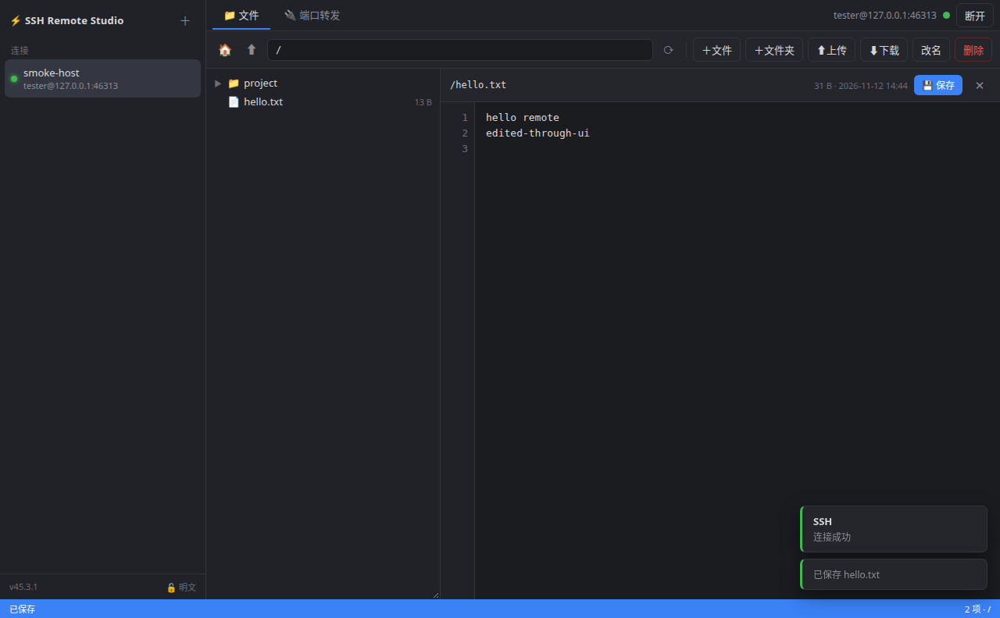
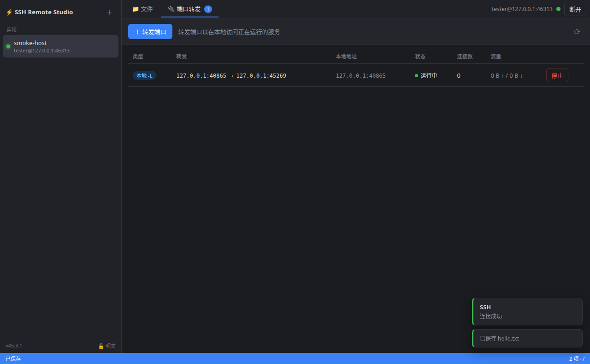

# ⚡ SSH Remote Studio

一个 **Windows 桌面 SSH 远程工具**：通过 SSH 打开远程计算机上的任意文件夹，在应用内浏览与编辑远程文件，并像 VS Code 一样管理**端口转发**（本地 `-L` / 远程 `-R` / 动态 SOCKS `-D`）。

技术栈：**Electron + Node.js + [ssh2](https://github.com/mscdex/ssh2)**，渲染层为原生 HTML/CSS/JS（无前端框架、无打包器），主进程与核心逻辑完全解耦、可独立测试。




---

## 功能

- **连接管理**：保存多个连接配置；支持 **密码 / 私钥文件 / SSH Agent** 三种认证；私钥口令可选。
- **远程文件**：懒加载目录树、路径跳转、新建文件/文件夹、**打开并编辑文本文件（Ctrl+S 保存回远程）**、上传/下载、重命名、递归删除；二进制文件检测与超大文件保护。
- **端口转发**（对标 VS Code 端口面板）：
  - **本地 `-L`**：本地端口 → 远程可达的目标服务（如把远程数据库映射到本地）。
  - **远程 `-R`**：远程主机端口 → 本地服务。
  - **动态 `-D`**：本地 SOCKS5 代理，经 SSH 隧道访问远程网络。
  - 实时显示状态、连接数、上下行流量；可停止；监听端口填 `0` 自动分配。
- **安全**：
  - 主机密钥 **TOFU**（首次信任并记录，再次连接校验，不一致则拒绝并告警）。
  - 密码/私钥口令用系统加密存储（Windows DPAPI / macOS Keychain / Linux libsecret，经 Electron `safeStorage`）。
  - 渲染层 `contextIsolation` 开启、`nodeIntegration` 关闭，仅暴露白名单 `window.api`。
  - 配置列表接口**不回传明文密钥**。

## 目录结构

```
src/
  core/            # 与 Electron 解耦的核心（可纯 Node 测试）
    ssh-session.js     # SSH 连接生命周期 / 认证 / TOFU / exec / SFTP 复用
    sftp-service.js    # 远程文件操作
    forward-service.js # 本地/远程/动态 SOCKS5 转发
    store.js           # 配置持久化 + 可选加密
    remote-manager.js  # 会话聚合门面（IPC 的唯一对接面）
    util.js
  main/            # Electron 主进程
    main.js            # 窗口/菜单/单实例/safeStorage
    ipc.js             # IPC 处理器 + 事件推送
    preload.js         # 安全桥接 window.api
  renderer/        # 渲染层 UI（原生 JS）
    index.html / styles.css
    ui.js / connections.js / files.js / ports.js / app.js
test/
  test-server.js       # 进程内测试 SSH 服务（ssh2.Server + fs 后端 SFTP + 转发）
  integration.test.js  # 11 项核心集成测试
  ui-smoke.js          # 13 项端到端 UI 冒烟测试（真实 UI+IPC+核心+SSH）
scripts/
  make-icon.py         # 生成图标（Pillow）
  build-win.sh         # 本机交叉构建 Windows 安装包
```

## 开发

```bash
npm install
npm start              # 启动应用
```

> 本机（Linux）若 npm 缓存目录有 root 文件导致 EACCES，或 Electron 二进制下载失败，
> 见下方「构建环境注意事项」，用工作区缓存 + 镜像即可。

## 测试

```bash
npm test               # 核心集成测试（11 项，进程内真实 SSH 协议）
npm run smoke:headless # 端到端 UI 冒烟（Linux 无头，需 xvfb-run）
npm run smoke          # 端到端 UI 冒烟（有桌面环境）
```

核心测试覆盖：密码/密钥认证、错误密码拒绝、exec、SFTP 增删改查/二进制检测/大小保护/上传下载、**本地/动态/远程三种转发端到端**、TOFU 主机密钥、存储加密不泄漏。
UI 冒烟覆盖：真实渲染层启动 → 连接 → 目录树 → 打开/编辑/保存远程文件 → 添加转发 → **转发真实隧道连通** → 零控制台错误，并输出截图到 `build/`。

## Windows 打包

**在 Windows 上（推荐，生成安装程序）：**

```bash
npm install
npm run dist:win       # NSIS 安装包 + 便携版到 release/
```

产物：`release/SSH Remote Studio-0.1.0-x64.exe`（NSIS 安装包，可选安装目录、创建桌面/开始菜单快捷方式）。

**在 Linux 上交叉构建（本仓库已验证，无需 wine）：**

```bash
bash scripts/build-win.sh      # 等价于 npm run dist:win:zip
```

产物：`release/SSH Remote Studio-0.1.0-x64.zip`（**完整便携版**，解压后运行其中的 `SSH Remote Studio.exe`）。

> 说明：NSIS 安装器的最后一步需要 wine，Linux 上通常没有，因此交叉构建默认产出 **zip 便携版**（功能完全一致）。
> 想要 NSIS 安装器，请在 Windows 上执行 `npm run dist:win`，或在 Linux 安装 wine 后执行 `npx electron-builder --win nsis`。
> 无论哪种方式，`release/win-unpacked/` 都是可直接运行的完整 Windows 应用目录。

### 构建环境注意事项（Linux / 受限网络）

- npm 缓存改用工作区目录，避免 `~/.npm` 的 root 文件导致 `EACCES`：
  `export npm_config_cache=$PWD/../.npm-cache`
- Electron 二进制与 electron-builder 二进制走 npmmirror 镜像：
  ```bash
  export ELECTRON_MIRROR=https://cdn.npmmirror.com/binaries/electron/
  export ELECTRON_BUILDER_BINARIES_MIRROR=https://npmmirror.com/mirrors/electron-builder-binaries/
  export electron_config_cache=$PWD/../.cache/electron   # 避免 ~/.cache 不可写
  ```
- 图标由 `python3 scripts/make-icon.py` 生成（需 Pillow）。

## 使用说明

1. **新建连接**：左侧 `＋`（或 Ctrl+N）→ 填主机/端口/用户名 → 选认证方式 → 「保存并连接」。
2. **浏览/编辑文件**：连接后在「文件」页展开目录树，点文件打开，编辑后 `Ctrl+S` 保存；工具栏可新建/上传/下载/改名/删除。
3. **端口转发**：切到「端口转发」页 → 「转发端口」→ 选类型并填端口 → 「转发」。列表可看状态/流量并停止。

## 已知限制 / 后续可增强

- 编辑器为轻量文本编辑（等宽 + 行号 + Tab 缩进），未集成语法高亮；可后续接入 CodeMirror 6。
- 远程路径按 POSIX 处理（面向 Linux/Unix 远程主机）。
- 未实现 SSH 跳板机（ProxyJump）、`~/.ssh/config` 导入、远程终端（shell）——可作为下一步。
- 主机密钥策略默认 TOFU；可在设置中改为严格校验（`hostKeyPolicy`）。

## 许可

MIT
