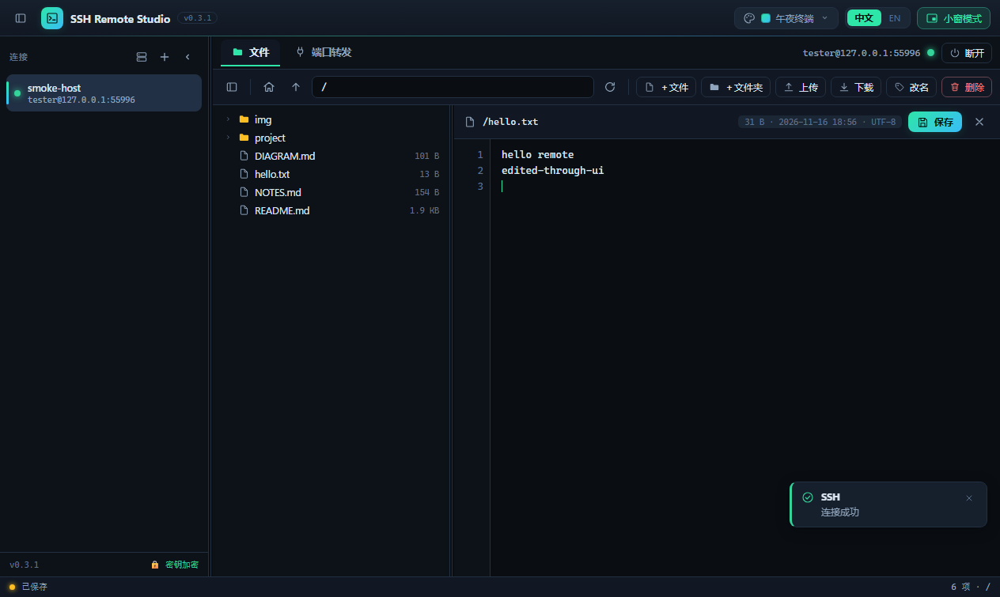
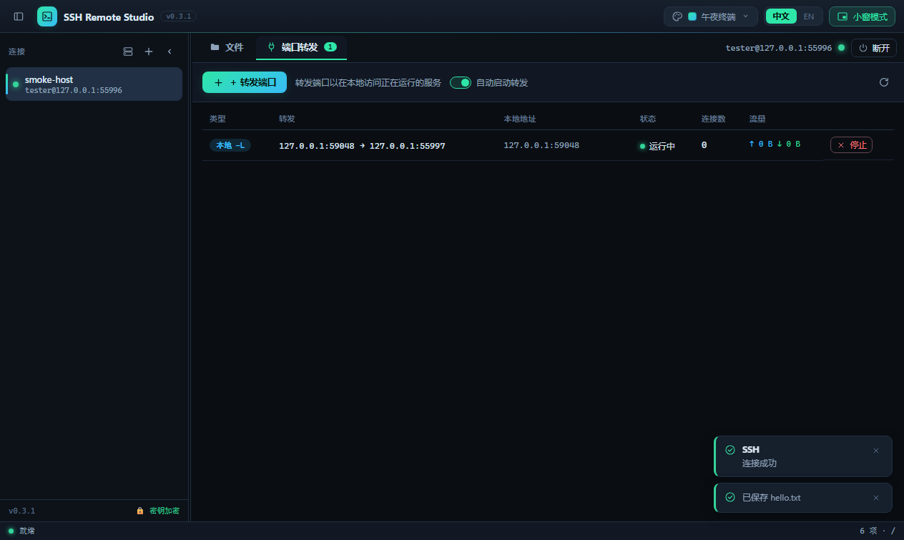
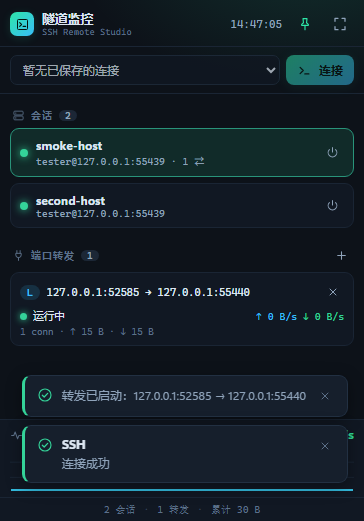

# ⚡ SSH Remote Studio

**SSH 隧道工作台**：图形化管理本地 `-L`、远程 `-R` 与动态 SOCKS `-D` 转发——隧道可保存、断线可恢复、流量可观测；**无需在远端安装任何 agent**。支持从 `~/.ssh/config` 导入主机、跳板机与转发规则，内置远程文件浏览与轻量编辑，方便隧道排障时直接修改远端配置。

跨平台桌面应用（**Windows 优先；macOS / Linux 为 beta**），技术栈：**Electron + Node.js + [ssh2](https://github.com/mscdex/ssh2)**，渲染层为原生 HTML/CSS/JS（无前端框架、无打包器），主进程与核心逻辑完全解耦、可独立测试。





---

## 产品定位

**适合谁**

- 需要长期、重复访问内网数据库、管理台、消息队列等服务的开发、后端、DBA 与运维/SRE。
- 需要在无法安装 VS Code Server 或任何 agent 的受限服务器上维护配置文件的场景。
- 同时管理多条隧道，且关心连接状态、流量与断线恢复的用户。

**不适合谁**

- 需要交互式远程终端或完整 IDE 的用户：当前版本**不提供远程 shell**，也不试图替代 VS Code。
- 需要文件同步、网盘或团队协作/云同步的用户：当前不做这些方向。

**与常见方案的关系**

- 相比 VS Code Remote-SSH：它是 IDE 优先的远程开发工具，Ports 面板主要覆盖 `-L`，且转发随窗口会话结束；本工具以隧道为一等公民，覆盖 `-L/-R/-D`，支持定义持久化与重启恢复，且不需要在远端安装服务端。
- 相比 Termius / MobaXterm / FinalShell / WindTerm：它们以终端为中心，端口转发只是其中一项功能；本工具当前不做终端，专注隧道的创建、恢复与可观测性。

## 功能

### 端口转发（核心）

- **本地 `-L`**：本地端口 → 远程可达的目标服务（如把远程数据库映射到本地）。
- **远程 `-R`**：远程主机端口 → 本地服务。
- **动态 `-D`**：本地 SOCKS5 代理，经 SSH 隧道访问远程网络。
- 实时显示状态、连接数、上下行流量与实时速率；监听端口填 `0` 自动分配。
- **失败重试上限**：监听失败自动重试 5 次，仍未成功则标记为**断开**并停止重试；列表保留该记录，可手动「启动」重试。
- **停止不删除**：停止转发只断开监听、记录保留（状态「断开」）；只有「删除」才会移除记录，断开 SSH 连接也不删除记录。
- 监听地址非回环时（如 `0.0.0.0`）表单会提示端口将对局域网开放。

### 持久化与隧道监控

- 转发定义随连接保存；重启后恢复配置并自动重连上次的会话。开启「自动启动转发」会重新监听；关闭时配置仍保留为断开状态，可随时手动启动。
- **小窗模式（隧道监控）**：`Ctrl+M` 或顶栏按钮把窗口收成一个置顶小窗——实时显示活动会话、每条转发的状态 / 连接数 / 上下行速率与累计流量、聚合吞吐趋势图，支持快速连接、断开会话、停止转发；一键展开回主窗口。

### 连接与安全

- **连接管理**：保存多个连接配置；支持 **密码 / 私钥文件 / SSH Agent** 三种认证；私钥口令可选；支持 **ProxyJump 跳板机** 多级链路；可为每个连接设置**主目录**（绝对路径或 `~`，留空使用服务端默认目录）。
- **`~/.ssh/config` 导入**：读取 Host / HostName / User / Port / IdentityFile / ProxyJump，以及 LocalForward / RemoteForward / DynamicForward；通配符与否定匹配按 OpenSSH 语义处理，导入后可直接连接并恢复转发。
- **主机密钥 TOFU**（首次信任并记录，再次连接校验，不一致则拒绝并告警）；可按连接选择 **严格** 或 **全部接受**。
- 密码/私钥口令用系统加密存储（Windows DPAPI / macOS Keychain / Linux libsecret，经 Electron `safeStorage`）；配置文件以 `0600` 写入，回退明文时也不会被其他本地用户读取。
- 渲染层 `contextIsolation` + `sandbox` 开启、`nodeIntegration` 关闭，仅暴露白名单 `window.api`；禁止页面导航与内嵌新窗口。
- 配置列表接口**不回传明文密钥**；已保存的密码/口令可显式清除。

### 远程文件（辅助）

- 懒加载目录树、路径跳转、新建文件/文件夹、**打开并编辑文本文件（Ctrl+S 保存回远程）**、上传/下载、重命名、递归删除；二进制文件检测与超大文件保护。
- **保存前校验远端是否已被改动**，冲突时提示覆盖而非静默覆盖；**删除符号链接只移除链接本身**，不会波及链接目标目录。
- 用于隧道排障时快速查看/修改远端配置，不定位为完整 IDE。
- **Markdown 预览**：打开 `.md` / `.markdown` 文件默认进入安全预览（原始 HTML 不执行），支持标题、列表、表格、代码块、引用、链接与图片；相对/绝对远端图片经 SFTP 读取后以 data URL 展示，也支持 `http(s)` 图片；可一键切回编辑。

### 布局与个性化

- **面板最小化**：连接面板可从侧栏或顶栏收起/恢复；文件树可从工具栏收起/恢复。
- **拖动调整宽度**：鼠标拖动连接面板与文件树的分隔条调整宽度，双击分隔条恢复默认；宽度与收起状态本地持久化。
- **4 套主题**：午夜终端（默认）/ 日光纸白 / 复古荧光 / 星云紫，顶栏一键切换并持久化。
- **中 / 英双语**：界面全量国际化（含菜单与错误提示），顶栏切换并持久化。

## 目录结构

```
src/
  core/            # 与 Electron 解耦的核心（可纯 Node 测试）
    ssh-session.js     # SSH 连接生命周期 / 认证 / TOFU / ProxyJump / exec / SFTP 复用
    ssh-config.js      # ~/.ssh/config 解析、Host 匹配与导入画像
    sftp-service.js    # 远程文件操作
    forward-service.js # 本地/远程/动态 SOCKS5 转发
    store.js           # 配置持久化 + 可选加密
    remote-manager.js  # 会话聚合门面（IPC 的唯一对接面）
    util.js
  main/            # Electron 主进程
    main.js            # 窗口/菜单（双语）/单实例/safeStorage
    ipc.js             # IPC 处理器 + 事件推送 + 小窗窗口管理
    preload.js         # 安全桥接 window.api
    safe-storage.js    # 系统加密存储适配
  renderer/        # 渲染层 UI（原生 JS）
    index.html / styles.css   # 4 主题设计系统（CSS 变量）
    i18n.js            # 中/英字典与 data-i18n 应用
    layout.js          # 面板最小化 / 拖动宽度 / 布局持久化
    markdown.js        # 安全 Markdown 渲染（图片保留远端路径）
    ui.js / connections.js / files.js / ports.js / app.js
    mini.js            # 小窗「隧道监控」+ 每秒流量监控引擎
test/
  test-server.js       # 进程内测试 SSH 服务（ssh2.Server + fs 后端 SFTP + 转发）
  integration.test.js  # 28 项核心集成测试（含 ProxyJump、符号链接删除、保存冲突、转发持久化与重启恢复）
  ssh-config.test.js   # 6 项 SSH config 解析 / 匹配 / 导入测试
  markdown.test.js     # 4 项 Markdown 渲染与安全转义测试
  ui-smoke.js          # 61 项端到端 UI 冒烟测试（真实 UI+IPC+核心+SSH）
scripts/
  make-icon.py         # 生成图标（Pillow）
  build-win.sh         # 本机交叉构建 Windows 安装包
.github/workflows/ci.yml  # 三平台集成测试 + Linux 无头冒烟配置
LICENSE                  # MIT
```

## 开发

```bash
npm install
npm start              # 启动应用
```

> 本机（Linux）若 npm 缓存目录有 root 文件导致 EACCES，或 Electron 二进制下载失败，
> 见下方「构建环境注意事项」，用工作区缓存 + 镜像即可。

## 测试

```bash
npm test               # 核心测试（28 项集成 + 6 项 SSH config 解析 + 4 项 Markdown 渲染，进程内真实 SSH 协议）
npm run smoke:headless # 端到端 UI 冒烟（Linux 无头，需 xvfb-run）
npm run smoke          # 端到端 UI 冒烟（有桌面环境）
```

> 全部测试基于进程内 SSH 服务，**三个平台（Windows / macOS / Linux）均可直接运行**，无需外部 SSH 服务器。
> `.github/workflows/ci.yml` 提供 Ubuntu / macOS / Windows 集成测试与 Ubuntu xvfb UI 冒烟配置。
> 极少数断言依赖平台能力（POSIX 权限位、符号链接），在不支持的平台上会自动跳过。

核心测试覆盖：密码/密钥认证、错误密码拒绝、exec（含输出上限）、SFTP 增删改查/二进制检测/大小保护/上传下载、**递归删除不跟随符号链接**、**保存冲突检测**、**本地/动态/远程三种转发端到端**、**端口 0 重启重新分配**、**关闭自动启动时转发配置仍可见并可手动启动**、**重复端点不产生重复定义**、TOFU 主机密钥、**ProxyJump 跳板机连接与失败定位**、**SSH config 解析/通配符/首值优先/转发与跳板机导入**、**Markdown 渲染/HTML 转义/危险链接过滤/图片占位**、**凭据显式清除**、**配置文件权限**、存储加密不泄漏。
UI 冒烟覆盖：真实渲染层启动 → 连接 → 目录树 → 打开/编辑/保存远程文件 → **保存冲突提示** → **清除凭据与主机密钥策略入口** → **监听地址暴露警告** → 添加转发 → **转发真实隧道连通** → **主题切换与持久化** → **中英文切换与持久化** → **小窗模式与展开还原** → **SSH config 导入 → 跳板机连接 → 导入转发恢复** → **自定义主目录生效且 Home 按钮返回该目录** → **Markdown 预览与远端图片 data URL** → **Sidebar/文件树最小化、拖动宽度与恢复** → **关闭自动启动后已保存转发仍显示并可手动启动** → 零控制台错误，并输出截图到 `build/`（无显示表面时截图自动跳过，不影响断言）。

## 打包

在**目标平台**上构建对应产物（electron-builder 不支持跨平台构建 macOS/Linux 安装包）：

```bash
npm install

# Windows（在 Windows 上）
npm run dist:win        # NSIS 安装包 + 便携版 → release/

# Linux（在 Linux 上）
npm run dist:linux      # AppImage + .deb → release/

# macOS（在 macOS 上）
npm run dist:mac        # .dmg + .zip（x64 + arm64）→ release/
```

产物示例（版本号随 `package.json`）：

| 平台 | 产物 |
|---|---|
| Windows | `release/SSH Remote Studio-0.3.1-x64.exe`（NSIS 安装包）、`…-portable.exe` |
| Linux | `release/SSH Remote Studio-0.3.1-x64.AppImage`、`…-x64.deb`（beta，需在 Linux 构建验证） |
| macOS | `release/SSH Remote Studio-0.3.1-x64.dmg` / `…-arm64.dmg`（beta，需在 macOS 构建验证） |

> **下载现成版本**：前往 [GitHub Releases](https://github.com/wufangqi/SSH-Remote-Studio/releases) 获取各平台安装包。
> 当前仓库内的发布产物仅覆盖 Windows；macOS / Linux 的构建配置已提供，但尚未完成真机构建验证，标记为 beta。

> **Windows 在 Linux 上交叉构建**（无需 wine，产出 zip 便携版）：`bash scripts/build-win.sh`，等价于 `npm run dist:win:zip`。
> NSIS 安装器最后一步需要 wine，Linux 上通常没有，因此交叉构建默认产出 zip 便携版（功能完全一致）。
> 无论哪种方式，`release/win-unpacked/` 都是可直接运行的完整 Windows 应用目录。

### 各平台说明

| 项 | Windows | macOS | Linux |
|---|---|---|---|
| 状态 | 优先支持 | beta | beta |
| 凭据加密 | DPAPI | Keychain | libsecret / gnome-keyring（无则回退明文并提示） |
| SSH Agent | Pageant / OpenSSH Agent | `SSH_AUTH_SOCK` | `SSH_AUTH_SOCK` |
| 运行 | 双击 exe | `open -a "SSH Remote Studio"` | `./SSH Remote Studio-*.AppImage` |
| 签名 | 未配置（跳过） | 未配置（跳过，需自行签名/公证） | 不适用 |

- **Linux 以 root 运行时**需加 `--no-sandbox`（Chromium 沙箱限制），或在普通用户下运行。
- **Linux 无桌面/无密钥环**：凭据加密不可用时自动回退明文存储，状态栏会显示「明文存储」。

### 构建环境注意事项（受限网络）

- npm 缓存改用工作区目录，避免 `~/.npm` 的 root 文件导致 `EACCES`：
  `export npm_config_cache=$PWD/../.npm-cache`
- Electron 二进制与 electron-builder 二进制走 npmmirror 镜像：
  ```bash
  export ELECTRON_MIRROR=https://cdn.npmmirror.com/binaries/electron/
  export ELECTRON_BUILDER_BINARIES_MIRROR=https://npmmirror.com/mirrors/electron-builder-binaries/
  export electron_config_cache=$PWD/../.cache/electron   # 避免 ~/.cache 不可写
  ```
- 图标由 `python3 scripts/make-icon.py` 生成（需 Pillow）：`build/icon.png` 1024×1024（macOS/视网膜）+ `build/icon.ico`（Windows）。

## 使用说明

1. **新建连接**：左侧 `＋`（或 Ctrl+N，macOS 为 ⌘N）→ 填主机/端口/用户名 → 选认证方式 → 「保存并连接」。编辑已有连接时，可勾选「清除已保存的密码/口令」；「主机密钥校验」可按连接选择 TOFU / 严格 / 全部接受；「主目录」可填写 `/var/www`、`~/projects` 等起始目录，留空使用服务端默认主目录。
   - **从 SSH config 导入**：点击侧栏的服务器图标，选择要导入的 Host。私钥路径、跳板机与转发规则会一并导入；主连接密码需在连接设置中补充，跳板机使用配置中的私钥 / Agent。
2. **端口转发**：切到「端口转发」页 → 「转发端口」→ 选类型并填端口 → 「转发」。列表可看状态/流量/实时速率；「停止」保留记录（状态断开），「启动」重新监听，「删除」才会移除记录。悬停行可复制本地地址。
3. **小窗模式**：`Ctrl+M`（macOS ⌘M；或顶栏「小窗模式」、视图菜单）进入置顶隧道监控小窗；图钉按钮可取消置顶；`Ctrl+M` 或展开按钮回到主窗口。
4. **浏览/编辑文件**：连接后在「文件」页展开目录树，点文件打开，编辑后 `Ctrl+S`（macOS ⌘S）保存；工具栏可新建/上传/下载/改名/删除。该能力用于隧道排障时的配置查看与修改。
5. **Markdown 预览**：打开 `.md` / `.markdown` 文件默认显示预览；编辑器头部的「编辑 / 预览」按钮切换。相对路径图片会经当前 SSH 会话读取，远端不存在的图片会显示失败提示。
6. **面板布局**：顶栏最左侧按钮或侧栏 `‹` 收起连接面板；文件工具栏最左侧按钮收起文件树；拖动两条分隔条调整宽度，双击分隔条恢复默认。布局自动保存。
7. **主题与语言**：顶栏右侧调色板按钮切换 4 套主题；`中文 / EN` 分段按钮切换界面语言；两者均自动保存。

## 已知限制与路线图

**当前非目标**

- 不提供远程终端（shell），不替代 VS Code 或其他 IDE；是否加入终端将根据目标用户验证结果再评估。
- 不做文件同步、网盘、团队协作或云同步。

**已知限制**

- 远程路径按 POSIX 处理（面向 Linux/Unix 远程主机）。
- 自定义主目录必须存在且为目录；无效路径会回退到服务端默认主目录并提示。
- 编辑器为轻量文本编辑（等宽 + 行号 + Tab 缩进），未集成语法高亮。
- Markdown 预览为内置安全子集：不执行原始 HTML；单张远端图片读取上限 20 MiB；支持相对/绝对远端路径与 `http(s)` 图片。
- `~/.ssh/config` 的 `Include` 与 `Match` 暂不展开；导入时会提示，相关 Host 需直接写入主配置。
- 导入的跳板机认证沿用 SSH config（私钥 / Agent）；跳板机密码认证暂未提供编辑入口，清除后可重新导入。
- 断线后的自动重连与健康检查、隧道分组与批量启停尚未实现。
- Windows 已完成开发与全量测试；macOS / Linux 的应用代码已做平台适配，构建配置与脚本已提供，但安装包需在对应平台构建验证（beta）。
- 安装包当前未配置代码签名。

**路线图（隧道优先）**

1. **M2 已完成**：ProxyJump 多级跳板机、`~/.ssh/config` 导入（Host / ProxyJump / LocalForward / RemoteForward）、导入转发随连接恢复。
2. **M2 后续**：自动重连与健康检查、隧道分组与批量启停、失败原因诊断增强、`Include` / `Match` 展开。
3. **M3 分发与验证**：三平台 CI 跑通与产物验证、Windows 代码签名、目标用户场景验证。
4. **后续评估**：语法高亮编辑器、终端、团队共享；在目标用户验证前不默认投入。

## 许可

MIT（见 [LICENSE](LICENSE)）
