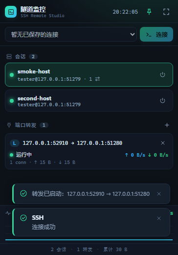

# ⚡ SSH Remote Studio

一个 **跨平台桌面 SSH 远程工具**（**Windows / macOS / Linux**）：通过 SSH 打开远程计算机上的任意文件夹，在应用内浏览与编辑远程文件，并像 VS Code 一样管理**端口转发**（本地 `-L` / 远程 `-R` / 动态 SOCKS `-D`）。

技术栈：**Electron + Node.js + [ssh2](https://github.com/mscdex/ssh2)**，渲染层为原生 HTML/CSS/JS（无前端框架、无打包器），主进程与核心逻辑完全解耦、可独立测试。




---

## 功能

- **连接管理**：保存多个连接配置；支持 **密码 / 私钥文件 / SSH Agent** 三种认证；私钥口令可选。
- **远程文件**：懒加载目录树、路径跳转、新建文件/文件夹、**打开并编辑文本文件（Ctrl+S 保存回远程）**、上传/下载、重命名、递归删除；二进制文件检测与超大文件保护。
- **端口转发**（对标 VS Code 端口面板）：
  - **本地 `-L`**：本地端口 → 远程可达的目标服务（如把远程数据库映射到本地）。
  - **远程 `-R`**：远程主机端口 → 本地服务。
  - **动态 `-D`**：本地 SOCKS5 代理，经 SSH 隧道访问远程网络。
  - 实时显示状态、连接数、上下行流量与实时速率；监听端口填 `0` 自动分配。
  - **失败重试上限**：监听失败自动重试 5 次，仍未成功则标记为**断开**并停止重试；列表保留该记录，可手动「启动」重试。
  - **停止不删除**：停止转发只断开监听、记录保留（状态「断开」）；只有「删除」才会移除记录，断开 SSH 连接也不删除记录。
- **安全**：
  - 主机密钥 **TOFU**（首次信任并记录，再次连接校验，不一致则拒绝并告警）。
  - 密码/私钥口令用系统加密存储（Windows DPAPI / macOS Keychain / Linux libsecret，经 Electron `safeStorage`）。
  - 渲染层 `contextIsolation` 开启、`nodeIntegration` 关闭，仅暴露白名单 `window.api`。
  - 配置列表接口**不回传明文密钥**。
- **个性化**：
  - **4 套主题**：午夜终端（默认）/ 日光纸白 / 复古荧光 / 星云紫，顶栏一键切换并持久化。
  - **中 / 英双语**：界面全量国际化（含菜单与错误提示），顶栏切换并持久化。
- **小窗模式（隧道监控）**：`Ctrl+M` 或顶栏按钮把窗口收成一个置顶小窗——实时显示活动会话、每条转发的状态 / 连接数 / 上下行速率与累计流量、聚合吞吐趋势图，支持快速连接、断开会话、停止转发；一键展开回主窗口。
- **多会话与持久化**：左侧切换会话即切换右侧文件树 / 编辑器 / 转发面板（未保存修改会先确认）；转发定义随连接保存，重启后自动重连上次的会话并恢复全部监听（端口面板可开关「启动时恢复」）。

## 目录结构

```
src/
  core/            # 与 Electron 解耦的核心（可纯 Node 测试）
    ssh-session.js     # SSH 连接生命周期 / 认证 / TOFU / exec / SFTP 复用
    sftp-service.js    # 远程文件操作
    forward-service.js # 本地/远程/动态 SOCKS5 转发
    store.js           # 配置持久化 + 可选加密
    remote-manager.js  # 会话聚合门面（IPC 的唯一对接面）
    util.js
  main/            # Electron 主进程
    main.js            # 窗口/菜单（双语）/单实例/safeStorage
    ipc.js             # IPC 处理器 + 事件推送 + 小窗窗口管理
    preload.js         # 安全桥接 window.api
    safe-storage.js    # 系统加密存储适配
  renderer/        # 渲染层 UI（原生 JS）
    index.html / styles.css   # 4 主题设计系统（CSS 变量）
    i18n.js            # 中/英字典与 data-i18n 应用
    ui.js / connections.js / files.js / ports.js / app.js
    mini.js            # 小窗「隧道监控」+ 每秒流量监控引擎
test/
  test-server.js       # 进程内测试 SSH 服务（ssh2.Server + fs 后端 SFTP + 转发）
  integration.test.js  # 18 项核心集成测试（含转发持久化、重试上限与重启恢复）
  ui-smoke.js          # 33 项端到端 UI 冒烟测试（真实 UI+IPC+核心+SSH，含主题/语言/小窗/多会话切换/转发生命周期）
scripts/
  make-icon.py         # 生成图标（Pillow）
  build-win.sh         # 本机交叉构建 Windows 安装包
```

## 开发

```bash
npm install
npm start              # 启动应用
```

> 本机（Linux）若 npm 缓存目录有 root 文件导致 EACCES，或 Electron 二进制下载失败，
> 见下方「构建环境注意事项」，用工作区缓存 + 镜像即可。

## 测试

```bash
npm test               # 核心集成测试（18 项，进程内真实 SSH 协议）
npm run smoke:headless # 端到端 UI 冒烟（Linux 无头，需 xvfb-run）
npm run smoke          # 端到端 UI 冒烟（有桌面环境）
```

> 全部测试基于进程内 SSH 服务，**三个平台（Windows / macOS / Linux）均可直接运行**，无需外部 SSH 服务器。

核心测试覆盖：密码/密钥认证、错误密码拒绝、exec、SFTP 增删改查/二进制检测/大小保护/上传下载、**本地/动态/远程三种转发端到端**、TOFU 主机密钥、存储加密不泄漏。
UI 冒烟覆盖：真实渲染层启动 → 连接 → 目录树 → 打开/编辑/保存远程文件 → 添加转发 → **转发真实隧道连通** → **主题切换与持久化** → **中英文切换与持久化** → **小窗模式（会话/转发卡片、窗口状态、趋势图）与展开还原** → 零控制台错误，并输出截图到 `build/`（无显示表面时截图自动跳过，不影响断言）。

## 打包

在**目标平台**上构建对应产物（electron-builder 不支持跨平台构建 macOS/Linux 安装包）：

```bash
npm install

# Windows（在 Windows 上）
npm run dist:win        # NSIS 安装包 + 便携版 → release/

# Linux（在 Linux 上）
npm run dist:linux      # AppImage + .deb → release/

# macOS（在 macOS 上）
npm run dist:mac        # .dmg + .zip（x64 + arm64）→ release/
```

产物示例（版本号随 `package.json`）：

| 平台 | 产物 |
|---|---|
| Windows | `release/SSH Remote Studio-0.3.0-x64.exe`（NSIS 安装包）、`…-portable.exe` |
| Linux | `release/SSH Remote Studio-0.3.0-x64.AppImage`、`…-x64.deb` |
| macOS | `release/SSH Remote Studio-0.3.0-x64.dmg` / `…-arm64.dmg`（Apple Silicon 原生） |

> **Windows 在 Linux 上交叉构建**（无需 wine，产出 zip 便携版）：`bash scripts/build-win.sh`，等价于 `npm run dist:win:zip`。
> NSIS 安装器最后一步需要 wine，Linux 上通常没有，因此交叉构建默认产出 zip 便携版（功能完全一致）。
> 无论哪种方式，`release/win-unpacked/` 都是可直接运行的完整 Windows 应用目录。

### 各平台说明

| 项 | Windows | macOS | Linux |
|---|---|---|---|
| 凭据加密 | DPAPI | Keychain | libsecret / gnome-keyring（无则回退明文并提示） |
| SSH Agent | Pageant / OpenSSH Agent | `SSH_AUTH_SOCK` | `SSH_AUTH_SOCK` |
| 运行 | 双击 exe | `open -a "SSH Remote Studio"` | `./SSH Remote Studio-*.AppImage` |
| 签名 | 未配置（跳过） | 未配置（跳过，需自行签名/公证） | 不适用 |

- **Linux 以 root 运行时**需加 `--no-sandbox`（Chromium 沙箱限制），或在普通用户下运行。
- **Linux 无桌面/无密钥环**：凭据加密不可用时自动回退明文存储，状态栏会显示「明文存储」。

### 构建环境注意事项（受限网络）

- npm 缓存改用工作区目录，避免 `~/.npm` 的 root 文件导致 `EACCES`：
  `export npm_config_cache=$PWD/../.npm-cache`
- Electron 二进制与 electron-builder 二进制走 npmmirror 镜像：
  ```bash
  export ELECTRON_MIRROR=https://cdn.npmmirror.com/binaries/electron/
  export ELECTRON_BUILDER_BINARIES_MIRROR=https://npmmirror.com/mirrors/electron-builder-binaries/
  export electron_config_cache=$PWD/../.cache/electron   # 避免 ~/.cache 不可写
  ```
- 图标由 `python3 scripts/make-icon.py` 生成（需 Pillow）：`build/icon.png` 1024×1024（macOS/视网膜）+ `build/icon.ico`（Windows）。

## 使用说明

1. **新建连接**：左侧 `＋`（或 Ctrl+N，macOS 为 ⌘N）→ 填主机/端口/用户名 → 选认证方式 → 「保存并连接」。
2. **浏览/编辑文件**：连接后在「文件」页展开目录树，点文件打开，编辑后 `Ctrl+S`（macOS ⌘S）保存；工具栏可新建/上传/下载/改名/删除。
3. **端口转发**：切到「端口转发」页 → 「转发端口」→ 选类型并填端口 → 「转发」。列表可看状态/流量/实时速率；「停止」保留记录（状态断开），「启动」重新监听，「删除」才会移除记录。悬停行可复制本地地址。
4. **主题与语言**：顶栏右侧调色板按钮切换 4 套主题；`中文 / EN` 分段按钮切换界面语言；两者均自动保存。
5. **小窗模式**：`Ctrl+M`（macOS ⌘M；或顶栏「小窗模式」、视图菜单）进入置顶隧道监控小窗；图钉按钮可取消置顶；`Ctrl+M` 或展开按钮回到主窗口。

## 已知限制 / 后续可增强

- 编辑器为轻量文本编辑（等宽 + 行号 + Tab 缩进），未集成语法高亮；可后续接入 CodeMirror 6。
- 远程路径按 POSIX 处理（面向 Linux/Unix 远程主机）。
- 未实现 SSH 跳板机（ProxyJump）、`~/.ssh/config` 导入、远程终端（shell）——可作为下一步。
- 主机密钥策略默认 TOFU；可在设置中改为严格校验（`hostKeyPolicy`）。
- 本项目在 Windows 上完成开发与全量测试；macOS / Linux 的应用代码已做平台适配（凭据加密、SSH Agent、字体、菜单、窗口行为），构建配置与脚本已提供，但 **macOS/Linux 安装包需在对应平台构建验证**。

## 许可

MIT
